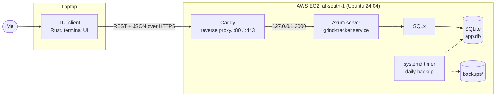

# Grind Tracker

A terminal app for practising DSA problems with spaced repetition. It keeps a problem set, schedules each problem's next review with [FSRS](https://github.com/open-spaced-repetition/fsrs-rs), and shows what is due, your stats and your progress in a TUI. A small Axum + SQLite server holds the data, so the same history is available from any machine.


https://github.com/user-attachments/assets/13071e07-d616-4195-9dda-45495b997130


## Why I built it

Solving a problem once doesn't mean I'll solve it again in a month. Lists and spreadsheets tell me what I have _done_, not what I am about to _forget_. Grind Tracker answers one question each day: **what should I review today?** It uses FSRS, a modern spaced-repetition scheduler, and lives in the terminal, where I already do the practice.

## Features

- Dashboard table of problems: number, title, difficulty, topic, FSRS state, due date, reps and lapses
- Stats cards: problems due today, problems reviewed, and your current streak
- Review flow: rate a problem 1 to 4 (Again / Hard / Good / Easy) and FSRS schedules the next review
- Problem set (number, title, slug, difficulty, topic tags) pulled from LeetCode and seeded automatically on first run
- Toast notifications and a themed UI
- Health endpoint and daily database backups in production

## How scheduling works

Each problem has an FSRS card storing its **stability**, **difficulty**, state, reps, lapses and the time of its last review. When you submit a review:

1. The server loads the card and works out the days elapsed since the last review.
2. FSRS computes the next memory state for all four ratings, with default parameters and a **target retention of 90%**.
3. The server picks the state for the rating you gave and sets the next due date to _now + interval_, where the interval is rounded to whole days with a minimum of one day.
4. The new stability, difficulty and due date are saved with the review.

The **streak** counts consecutive days with at least one review. It stays alive until the end of today if you haven't reviewed yet.

## Architecture



One crate, two binaries: `server` (the API) and `tui` (the client). Both live in `src/` as separate modules (`server/`, `tui/`) behind a shared library crate.

### API

| Method | Route            | Purpose                                           |
| ------ | ---------------- | ------------------------------------------------- |
| GET    | `/health`        | Liveness check                                    |
| GET    | `/api/dashboard` | Problems and their review state for the dashboard |
| GET    | `/api/stats`     | Data for the stat cards                           |
| POST   | `/api/review`    | Submit a rating for a problem                     |

### Design decisions worth knowing

- **Scheduler is separate from content.** FSRS decides _when_ to review; the problem set decides _what_. Either can change without touching the other.
- **SQLite on purpose.** One user, one writer, one file. It is trivial to back up and needs no database server. SQLx runs the migrations on startup and enables foreign keys on every connection.
- **Thin client.** The TUI renders state and sends actions to the server, so all scheduling logic exists in exactly one place.
- **Server is private by default.** It binds to loopback only, and Caddy is the only thing exposed.

## Running locally

```bash
export DATABASE_URL=sqlite:data/app.db
export ADDR=127.0.0.1:3000

cargo run --bin server   # terminal 1: runs migrations, seeds the problem set
cargo run --bin tui      # terminal 2: the client
```

Configuration is by environment variable:

| Variable       | Required | Meaning                                           |
| -------------- | -------- | ------------------------------------------------- |
| `DATABASE_URL` | yes      | e.g. `sqlite:data/app.db`                         |
| `ADDR`         | no       | Listen address, defaults to port 3000 on loopback |

## Deployment

Single EC2 instance (t3g.small, Ubuntu 24.04, af-south-1). The server is a Rust binary managed by systemd; Caddy terminates TLS and proxies to it.

| What        | Where                             |
| ----------- | --------------------------------- |
| Binary      | `/opt/grind-tracker/server`       |
| Environment | `/opt/grind-tracker/env`          |
| Database    | `/var/lib/grind-tracker/app.db`   |
| Backups     | `/var/lib/grind-tracker/backups/` |
| Service     | `grind-tracker.service`           |

Common operations:

```bash
journalctl -u grind-tracker -f             # logs
sudo systemctl restart grind-tracker       # restart
~/backup-db.sh                             # manual backup (a systemd timer runs it daily)
```

Security:

- SSH restricted to my IP
- Application not exposed directly to the internet (loopback only, behind Caddy)
- Runs as a non-root service user
- Automatic security updates enabled

## Project layout

```
src/
├── bin/            server.rs, tui.rs entry points
├── server/         Axum routes, DB access, problem-set seeding, errors
└── tui/            client, input handling, rendering (table, stats, review, toasts), theme
migrations/         SQLx migrations
```

## Tech

Rust · Axum · SQLx · SQLite · FSRS · Caddy · systemd · AWS EC2
